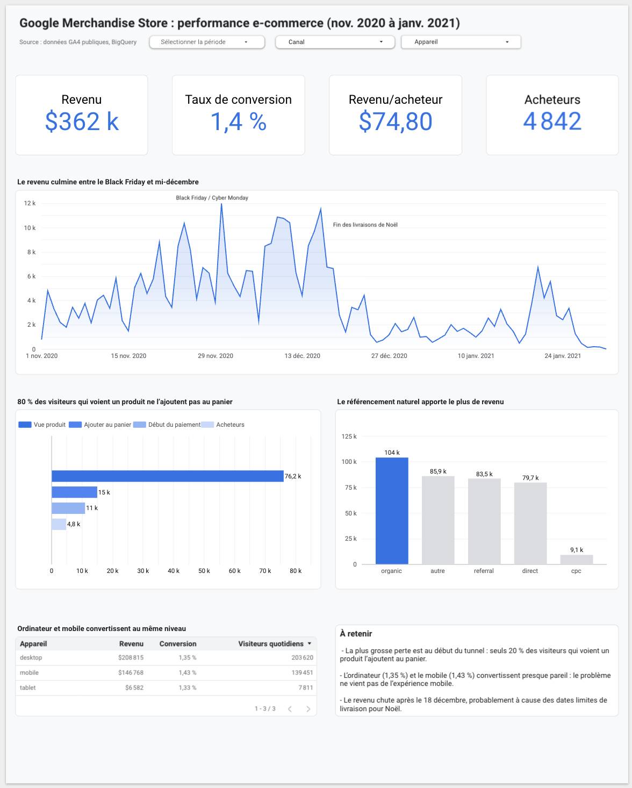

# GA4 e-commerce analysis: Google Merchandise Store

Where does the Google Merchandise Store lose its visitors, and which channels and devices actually bring revenue?

**[View the interactive dashboard](LIEN_LOOKER_STUDIO)**

## Data

Public GA4 sample dataset from BigQuery (`bigquery-public-data.ga4_obfuscated_sample_ecommerce`), covering November 2020 to January 2021. Each row is an event (page view, add to cart, purchase), so the queries first aggregate events into users per day.

## Method

1. Explored the event types and volumes (`01_events_overview.sql`)
2. Built the conversion funnel: product view, add to cart, checkout, purchase (`02_funnel.sql`)
3. Compared revenue and conversion rate by traffic channel (`03_channels.sql`)
4. Compared revenue and conversion rate by device (`04_devices.sql`)
5. Created a daily table by channel and device to feed the Looker Studio dashboard (`05_dashboard_source.sql`)

## Key findings

- **$362k revenue from 4,842 buyers**, with a 1.4% conversion rate and $74.80 revenue per buyer.
- **The biggest drop is at the top of the funnel**: only about 20% of users who view a product add it to their cart.
- **Device is not the issue**: desktop (1.35%) and mobile (1.43%) convert at almost the same rate.
- **Organic search brings the most revenue** ($104k), ahead of referral and direct traffic.
- **Revenue peaks between Black Friday and mid-December**, then drops sharply after December 18, probably because of Christmas delivery deadlines.

## Limitations

- Visitors are counted per day: a user who comes back on three different days is counted three times in the totals.
- The dataset is obfuscated by Google, so some channel values are masked ("(data deleted)", "<Other>") and grouped as "other" in the dashboard.

## Tools

BigQuery (SQL), Looker Studio
